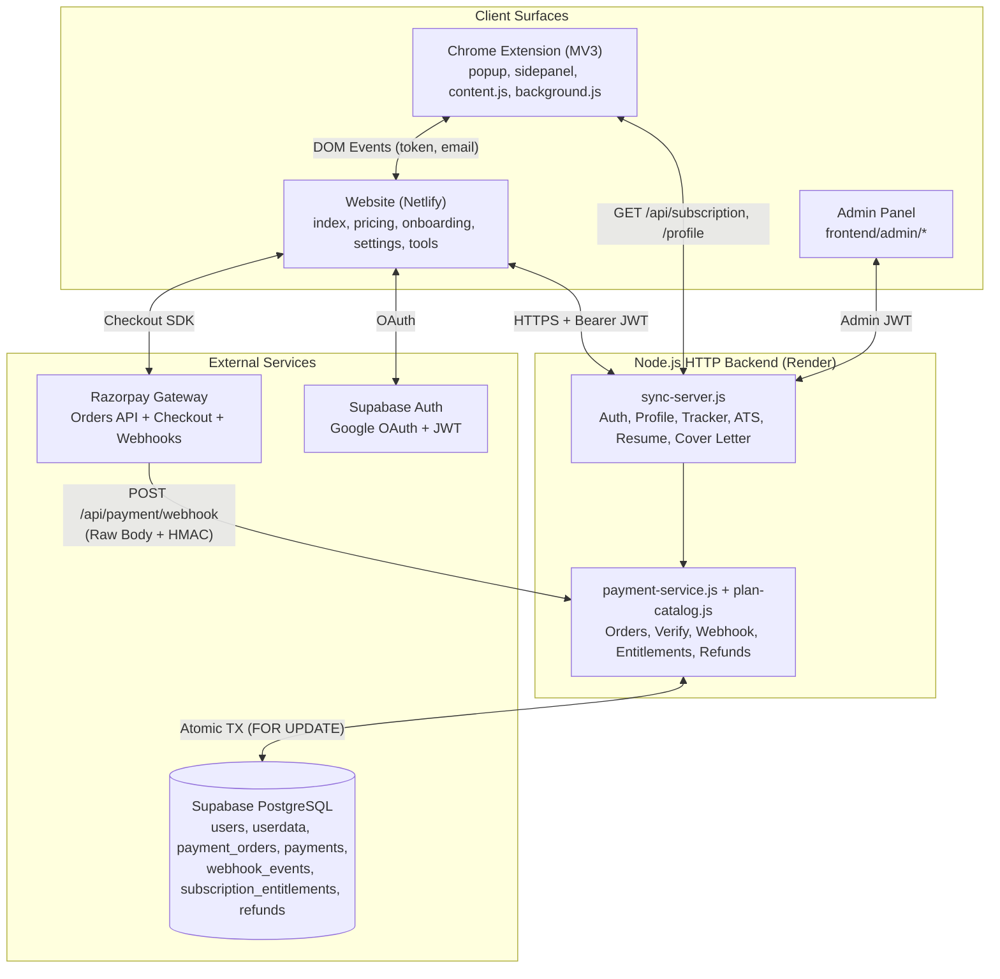
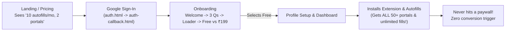
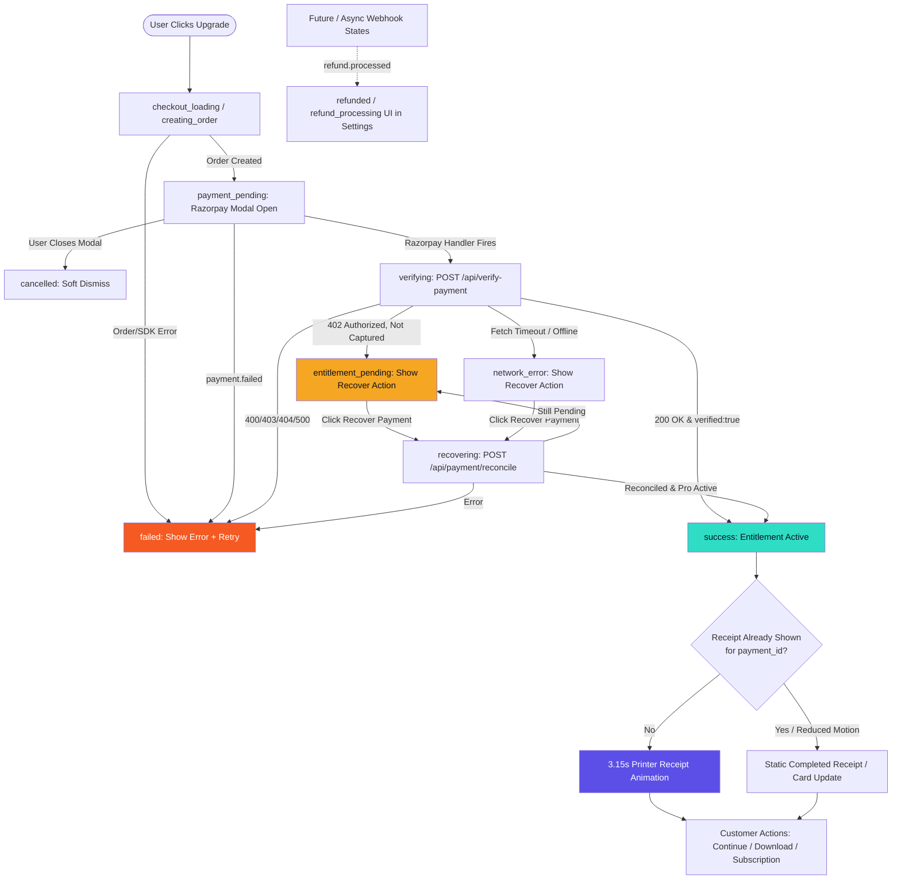

# JobXApply — Complete Monetization, Subscription, Feature Entitlement & Product Flow Audit

**Audit Date:** 2026-11-25  
**Scope:** End-to-end read-only audit of Website (`frontend/`), Backend (`backend/`), PostgreSQL Schema (`backend/db.js`), Chrome Extension (`extension/`), Admin Panel (`frontend/admin/`), and Live Deployments (`Netlify` + `Render`).  
**Supplementary Reports:**
- [JOBXAPPLY_FEATURE_ENTITLEMENT_MATRIX.md](file:///d:/Projects/CareerBridge/docs/JOBXAPPLY_FEATURE_ENTITLEMENT_MATRIX.md)
- [JOBXAPPLY_PAYMENT_AND_SUBSCRIPTION_STATE_MAP.md](file:///d:/Projects/CareerBridge/docs/JOBXAPPLY_PAYMENT_AND_SUBSCRIPTION_STATE_MAP.md)
- [JOBXAPPLY_MONETIZATION_QA_TEST_MATRIX.md](file:///d:/Projects/CareerBridge/docs/JOBXAPPLY_MONETIZATION_QA_TEST_MATRIX.md)
- [JOBXAPPLY_MONETIZATION_IMPLEMENTATION_ROADMAP.md](file:///d:/Projects/CareerBridge/docs/JOBXAPPLY_MONETIZATION_IMPLEMENTATION_ROADMAP.md)

---

## 1. Executive Summary

JobXApply has a **strong, security-hardened Razorpay payment backend** (server-side pricing, constant-time HMAC verification, raw-body webhooks, idempotency, composite `(user_id, environment)` PostgreSQL entitlements, and automatic expiry). However, as a **complete commercial SaaS product**, it currently has a fundamental commercial disconnect:

1. **Zero Feature/Quota Enforcement Between Free and Pro:** Nearly every feature advertised as Pro-only or limited on Free (`10 autofills/mo`, `LinkedIn + Naukri only`, `20 tracker entries`, `Basic (No Export)` Resume Builder, `--` Cover Letter Engine, `3 experience entries`) is **completely unlocked and unlimited for Free users** in both the website and Chrome Extension.
2. **Billing Model Copy Conflict:** Backend `plan-catalog.js` implements a **30-day one-time prepaid pass** (`one_time_prepaid`, no auto-renewal), whereas `index.html`, `pricing.html`, and `settings.html` still contain recurring subscription language (`"Per month"`, `"Cancel anytime"`, `"Renews on"`, `"Prorated credits"`).
3. **Missing Customer Billing & Admin Revenue Views:** `GET /api/subscription` already returns `payments[]`, yet `settings.html` renders no payment history/receipts, and `frontend/admin/` has zero visibility into `payment_orders`, `payments`, `webhook_events`, `refunds`, or Live vs. Test revenue.
4. **Live E2E & Real PG Verification Pending:** Public checkout is intentionally disabled (`publicCheckoutEnabled: false`), and live Render/Supabase end-to-end payment + webhook verification has not yet been executed.

---

## 2. Overall Weighted Readiness Score & Launch Recommendation

| Audit Category | Weight | Score (0–10) | Weighted | Key Evidence |
|---|---:|---:|---:|---|
| Plan consistency & feature entitlements | 15% | 2.5 | 0.375 | Free limits (10 autofills, 2 portals, 20 tracker, PDF/Cover Letter) are unenforced |
| Free user journey & upgrade conversion | 10% | 5.5 | 0.550 | Polished `onboarding.html` exists, but zero paywalls create upgrade urgency |
| Usage tracking & quota enforcement | 10% | 2.0 | 0.200 | Only hourly anti-abuse rate limits exist (`5/hr` vs `50/hr`); no monthly quotas |
| Website & extension synchronization | 10% | 7.0 | 0.700 | Extension fetches `GET /api/subscription` & caches with 24h TTL; manual sync needed in-session |
| Payment security & reliability | 15% | 8.5 | 1.275 | Server catalog, raw-body webhook, `FOR UPDATE` TX, idempotency; minor `emailVerified !== false` edge case |
| Subscription lifecycle | 10% | 7.5 | 0.750 | 30d prepaid activation, extension, auto-expiry, full/partial refunds implemented; UI uses `"Renews on"` |
| Database security & integrity | 10% | 7.5 | 0.750 | 5 tables + RLS + `REVOKE anon/authenticated` + composite PK; local PG TX unverified |
| Payment UX & customer billing | 5% | 5.0 | 0.250 | Clean `JobXApplyCheckout` states; missing billing history/receipts in `settings.html` |
| Admin panel & analytics | 5% | 3.5 | 0.175 | Admin has user tier toggle & 7 telemetry counters, zero payment/revenue/webhook views |
| Testing, edge cases & launch reliability | 10% | 6.5 | 0.650 | 185 automated tests pass (`39` payment mocked, `49` HTTP, `97` ext); no browser E2E or real PG test |
| **Weighted Overall Score** | **100%** | — | **5.68 / 10** | — |

### Commercial Launch Recommendation: **NO-GO** *(for immediate public launch)*
**Why:** While the Razorpay payment engine itself is well-engineered, launching publicly today would result in:
1. Paying ₹199 Pro users discovering Free users already receive unlimited autofills, all 50+ portals, unlimited tracker, and cover letters.
2. Customers seeing conflicting `"Renews on"` / `"Cancel anytime"` vs `"Prepaid"` disclosures.
3. No admin revenue/webhook failure visibility and no customer payment receipt history.
4. `user.emailVerified !== false` edge case and unverified live Render/Supabase E2E transaction.

---

## 3. Current Product Architecture



### Authoritative Sources of Truth
- **User Identity:** `users` table + Supabase/Backend JWT (`getRequestUser` in `backend/sync-server.js:690`).
- **Plan Pricing & Duration:** `backend/plan-catalog.js` (`pro`: `19900` paise, `INR`, `30` days, `one_time_prepaid`).
- **Subscription Validity:** `subscription_entitlements` table (`PRIMARY KEY (user_id, environment)`), resolved by `getEffectiveEntitlement()` (`backend/payment-service.js:354`).
- **Payment Status:** `payments` & `payment_orders` tables (`backend/db.js:85-118`).
- **Usage Limits:** Currently **split/missing** — only hourly rate limiters exist in `sync-server.js:2306, 2543`; pricing limits (`10 autofills`, `20 tracker`, `3 experiences`, `2 portals`) have no source of truth in backend or DB.

---

## 4. Complete Plan & Feature Inventory

### Plans Discovered
1. **Free Tier (`free`)** — `₹0`, no expiry. Advertised on `index.html:1966` & `pricing.html:119`.
2. **Pro Tier (`pro`)** — `₹199` (`~~₹299~~ ₹199` launch offer in `onboarding.html` & `settings.html`), `30 days` one-time prepaid access (`plan-catalog.js:10-14`). Legacy aliases `paid`, `premium`, `operative`, `command` normalize to `pro` (`plan-catalog.js:18`).
3. **Enterprise Tier** — `Custom` (`pricing.html:148`, `index.html:2000`). Contact-sales CTA only (`contact.html`); no multi-tenant backend features exist.

### Feature Inventory (12 Discovered User-Facing Features)
1. 1-Click Heuristic & ATS Portal Autofill (`extension/content.js`, `extension/shared.js`)
2. Programmatic Binary Vector PDF Resume Injection (`extension/resume-pdf-builder.js`)
3. Real-Time Job Description Scraper & ATS Matcher (`extension/jd-extractor.js`, `jd-matcher.js`)
4. Master Career Profile & Behavioral Q&A Vault (`frontend/profile-setup.html`)
5. Live ATS Resume Builder & PDF Export (`frontend/resume-builder.html`)
6. 10-Template Cover Letter Engine (`frontend/cover-letter.html`, `extension/cover-letter-engine.js`)
7. ATS Compatibility Scorer (`frontend/ats-checker.html`, `POST /api/ats/analyze`)
8. Job Application Tracker & Snapshot Proof (`frontend/tracker.html`, `POST /api/tracker`)
9. Cloud & Extension Sync + AES-256-GCM Vault (`frontend/shared-shell.js`, `frontend/settings.html`)
10. Salary & Negotiation Guide (`frontend/salary-calculator.html`)
11. Onboarding Goal Discovery & Checkout (`frontend/onboarding.html`)
12. Data Portability Export (JSON/CSV) (`frontend/settings.html`, `GET /api/profile/export`)

*(Full comparison table in [JOBXAPPLY_FEATURE_ENTITLEMENT_MATRIX.md](file:///d:/Projects/CareerBridge/docs/JOBXAPPLY_FEATURE_ENTITLEMENT_MATRIX.md))*

---

## 5. Free User Journey & Conversion Friction



- **Value Before Payment:** Very high — Free users immediately experience profile parsing, ATS scoring, resume building, and autofill.
- **Conversion Friction / Defect:** Because **none** of the Free plan limits (`10 autofills`, `2 portals`, `20 tracker`, `no PDF export`, `no cover letter`) are enforced, Free users never encounter a paywall or quota indicator, eliminating the primary motivation to upgrade to Pro.
- **Current Public Checkout Gate:** `publicCheckoutEnabled: false` intentionally returns `503` for non-allowlisted users pending live verification.

---

## 6. Usage Tracking, Quotas & Security Classification

| Restriction Type | Enforceable? | Current Status | Recommended Enforcement |
| :--- | :--- | :--- | :--- |
| **Resume / Cover Letter LaTeX API (`/api/resume/generate`, `/api/cover-letter/generate`)** | **Server-Enforceable** | Enforced (`5/hr` Free vs `50/hr` Pro) | Keep server-side via `getEffectiveEntitlement` |
| **Application Tracker 20-Entry Limit (`POST /api/tracker`)** | **Server-Enforceable** | **Missing** | Enforce in `POST /api/tracker` (count stored apps; block >20 on Free without deleting old rows on downgrade) |
| **Monthly Autofill Quota (10/mo Free)** | **Hybrid (Server-Tracked + Extension Check)** | **Missing** | Extension calls `POST /api/usage/autofill` (idempotent per form/tab session so retries/multi-fields on one page don't double-charge); server tracks monthly UTC counter (`YYYY-MM`) per `user_id` |
| **Enterprise Portal Maps (`Workday`, `Greenhouse`, `Lever`, `Ashby`)** | **Server-Gated Delivery + Extension UX** | **Missing** (`/api/maps` is public) | Move premium portal selector maps behind `GET /api/maps` authenticated tier check; keep LinkedIn/Naukri/basic heuristic free |
| **Client-Side PDF / Cover Letter UI** | **Client-Side (Bypassable via DevTools)** | **Missing** | Add UI paywall + watermarking/template limits for UX conversion, acknowledging client-side JS is not tamper-proof |

---

## 7. Website & Browser Extension Consistency Findings

1. **Extension Entitlement Sync (`extension/background.js:35-84`):** Fetches `GET /api/subscription` on startup, login (`saveAuth`), and purchase (`refreshEntitlement`), caching `{ tier, environment, expiresAt, fetchedAt }` with a 24h offline TTL and automatic expiry fallback to `free`.
2. **Inconsistency Found:**
   - **Auto-Refresh Gap:** If a user upgrades on the website in Tab A while the extension sidepanel is already open, `sidepanel.js` only updates when the user clicks the Sync icon (`spSyncBtn`) or reopens the panel.
   - **Terminology Drift:** `settings.html:529` displays `"Renews on [date]"` and `"Extend / Renew"`, whereas `onboarding.html:542` says `"prepaid, no auto-renewal"`.
   - **Outdated Legal Keys:** `privacy-terms.html:370` lists `ch_token` / `ch_passcode` instead of `jxa_*` and omits Razorpay & Supabase disclosures.

---

## 8. Database, Security & Known Concerns Assessment

All 5 PostgreSQL payment tables (`payment_orders`, `payments`, `webhook_events`, `subscription_entitlements`, `refunds`) exist in `backend/db.js:75-186` with foreign keys, indexes, RLS enabled, and `REVOKE ALL ... FROM anon, authenticated`.

### Specific Audit Checks (Phase 14)
1. **`user.emailVerified !== false` Vulnerability (`backend/payment-service.js:64`):**
   - **Confirmed Issue:** If `activeUser` comes from a token/DB object where `emailVerified` is `undefined`, `undefined !== false` evaluates to `true`, allowing an unverified email state to pass if upstream verification ever omitted the flag. **Fix:** Enforce `user.emailVerified === true` and ensure `getRequestUser` explicitly populates `emailVerified`.
2. **Real PostgreSQL Transaction Verification:**
   - **Status:** **Blocked Locally** (`psql` requires local password; remote Supabase connection is live on Render with `pgPersistence: true`). All 39 payment tests in `backend/payment-test-suite.js` ran against the in-memory transaction adapter, **not** real PostgreSQL `FOR UPDATE` locks.
3. **Test vs. Live Isolation:**
   - **Verified:** Composite PK `(user_id, environment)` on `subscription_entitlements`, `UNIQUE(environment, ...)` on orders/payments/webhooks/refunds, and environment checks in `getEffectiveEntitlement()` prevent test purchases or test refunds from modifying or granting live entitlements.
4. **Multiple Payment Attempts Under One Order:**
   - **Verified:** `payments` enforces `UNIQUE(environment, razorpay_payment_id)` (not `razorpay_order_id`), allowing multiple failed/retried payment attempts under the same order while preventing duplicate fulfillment of the same `razorpay_payment_id`.
5. **`payment.captured` + `order.paid` Deduplication:**
   - **Verified:** Tested via `Promise.all([verifyCheckoutAndFulfill, handleWebhook])` in `payment-test-suite.js` — entitlement extended by 30 days exactly once.

### Read-Only SQL Verification Queries (For Manual Supabase SQL Editor Check)
```sql
SELECT tablename, rowsecurity FROM pg_tables
WHERE schemaname = 'public' AND tablename IN ('payment_orders','payments','webhook_events','subscription_entitlements','refunds');

SELECT conname, pg_get_constraintdef(oid)
FROM pg_constraint
WHERE conrelid = 'subscription_entitlements'::regclass;

SELECT grantee, table_name, privilege_type
FROM information_schema.role_table_grants
WHERE grantee IN ('anon', 'authenticated')
  AND table_name IN ('payment_orders','payments','webhook_events','subscription_entitlements','refunds');
```

---

## 9. Payment Visualization, Billing History & Admin Findings

- **Missing Customer Billing History (`settings.html`):** `GET /api/subscription` returns `payments[]`, but `settings.html` does not render transaction rows or a printable receipt view.
- **Missing Admin Payment Dashboard (`frontend/admin/`):** `analytics.html` and `users.html` show no `payment_orders`, no `payments`, no Live vs. Test gross revenue separation, no `webhook_events` failure queue, and no admin reconciliation tool.
- **Suggested Minimal UI Wireframes (Key States):**
  - *Settings Billing History:* Table (`Date | Plan | Amount | Payment ID | Status | Receipt`) below the Pro/Free subscription card.
  - *Locked Feature Paywall Modal:* `"Feature Locked — [Feature Name]"` → `"You've used 10/10 free autofills this month"` → `"Unlock Unlimited Autofills & 50+ Portals for ₹199 (30-day prepaid, no auto-renewal)"` → `[Upgrade to Pro — ₹199]` / `[Maybe Later]`.
  - *Extension Free vs Pro Header:* `FREE (7/10 left)` with `"Upgrade"` link vs `PRO · 28d left` with expiry tooltip.
  - *Admin Revenue Card:* `Live Gross Revenue (INR) | Test Orders (Excluded) | Active Live Pro | Failed Webhooks`.

---

## 10. Automated Test Execution Results & Blocked Tests

| Suite | Total | Passed | Failed | Skipped | Notes |
|---|---:|---:|---:|---:|---|
| `node backend/payment-test-suite.js` | **39** | **39** | **0** | **0** | Uses mocked Razorpay API & in-memory TX store |
| `node backend/test-suite.js` | **49** | **49** | **0** | **0** | Live local HTTP server (`sync-server.js`) |
| `node extension/test-verifier.js` | **97** | **97** | **0** | **0** | Extension extraction, matching, PDF, autofill |
| **Blocked / Unexecuted** | — | — | — | — | 1) Real PostgreSQL `FOR UPDATE` TX test; 2) Live Render ₹199 Test Mode E2E + webhook; 3) Full browser Playwright E2E across `pricing`, `onboarding`, `settings`, and `extension` |

---

## 11. Business Decisions Requiring Founder Approval

1. **Which exact limits should be strictly enforced on Free vs. Pro?** (e.g., enforce the currently advertised `10 autofills/mo`, `LinkedIn + Naukri only`, `20 tracker entries`, and `Pro-only PDF/Cover Letter exports`, OR revise pricing copy to match a more generous Free tier?)
2. **14-Day Refund Policy (`pricing.html:225-226`):** Confirm whether to keep the *"refund if hired within 14 days"* guarantee and document it formally in `privacy-terms.html`, or revise it before launch.
3. **Price Display (`₹199` vs `₹299`):** Confirm whether the `₹299 → ₹199 Launch Offer` badge should appear consistently on `index.html` and `pricing.html` (currently only on `onboarding.html` and `settings.html`).
4. **Enterprise Tier:** Confirm keeping `"Enterprise Tier — Custom"` as a contact-sales lead form (`contact.html`) rather than building multi-tenant agency dashboards before launch.

---

## 12. Pre-Launch Checklist & Manual Founder Actions

- [ ] Set `TEST_CHECKOUT_EMAILS` in Render and run one end-to-end ₹199 Test Mode checkout + webhook delivery + extension sync verification.
- [ ] Run the 3 read-only SQL verification queries in Supabase SQL Editor to confirm `RLS`, `REVOKE anon/authenticated`, and composite PK `(user_id, environment)`.
- [ ] Approve & implement P0/P1 remediation phases (`MON-01` through `MON-08` in [JOBXAPPLY_MONETIZATION_IMPLEMENTATION_ROADMAP.md](file:///d:/Projects/CareerBridge/docs/JOBXAPPLY_MONETIZATION_IMPLEMENTATION_ROADMAP.md)).
- [ ] Switch Render to Live Mode (`rzp_live_*`, Live Webhook Secret, `ENABLE_PUBLIC_CHECKOUT=true`) and verify one controlled live ₹199 purchase.

---

## 13. PHASE 21 — Animated Payment Receipt & Premium Purchase Experience (Design & Audit)

**Design Status:** Proposed Specification (Design-Only — Awaiting Founder Approval; No Code Modified)  
**Target Integration:** Website Checkout Flows (`onboarding.html`, `pricing.html`, `settings.html`) + Extension Sync (`extension/background.js`, `extension/popup.js`)

---

### 13.1 Reference Animation Analysis

- **Reference:** [arslanagayev/payment-receipt-animation](https://github.com/arslanagayev/payment-receipt-animation) | Demo: `https://arslanagayev.github.io/payment-receipt-animation/`
- **License:** **MIT License** (© Arslan Agayev) — permissive; requires attribution if any code is reused, though JobXApply will implement an original design-system-native component from scratch.
- **Technical Stack:** Zero external dependencies (`index.html`, `style.css`, `script.js` using Vanilla JS, CSS transitions/keyframes, and Web Animations API; no Canvas, no WebGL, no GSAP/Lottie).
- **Observed Visual & Motion Mechanics:**
  1. **Trigger:** Interactive "Hold to Pay" button morphs its dimensions and border-radius into a dark horizontal thermal printer slot.
  2. **Paper Emergence:** Thermal paper feeds downward from the slot in stepped increments with brief micro-pauses, mimicking physical stepper-motor feed lines rather than a single linear slide.
  3. **Content Reveal:** Receipt rows reveal progressively via clipping/opacity as the paper emerges, followed by a subtle paper tear-off micro-drop.
  4. **Final Stamp:** A rotated `PAID` rubber stamp lands with scale-down + `mix-blend-mode: multiply` texture, followed by a confetti burst and action buttons.
  5. **Accessibility & Edge Craft:** Uses `aria-live`, `prefers-reduced-motion`, and CSS-masked jagged/perforated paper edges.
- **JobXApply Adaptation Decisions (Original Implementation):**
  - **Replace "Hold to Pay" Trigger:** Checkout is handled by Razorpay Checkout; the printer emerges **only** from the `verifying` state once `POST /api/verify-payment` (or `POST /api/payment/reconcile`) returns `ok: true` and `verified: true` with an active entitlement.
  - **Remove Confetti & Excessive 3D:** Exclude confetti particles and heavy 3D transforms to keep the experience crisp, authoritative, and aligned with JobXApply's dark glassmorphic UI.
  - **Brand & Palette Alignment:** Render the printer chassis in Deep Space Navy (`#0B1020` / `#141828`) with a cyan/teal (`#2FDDC4`, `--success`) LED and stamp for Live Mode, and amber (`#F5A623`, `--alert`) treatment + watermark for Test Mode.

---

### 13.2 Proposed JobXApply Receipt Design

#### Visual & Structural Specification
- **Backdrop:** Full-viewport glassmorphic overlay (`rgba(7, 10, 24, 0.85)`, `backdrop-filter: blur(16px)`), matching `.modal-overlay` in `frontend/style-glass.css`.
- **Virtual Printer Unit:** Minimalist matte-navy chassis (`#141828`) with subtle border (`rgba(255,255,255,0.14)`), status LED (`VERIFIED` in `--success` or `TEST MODE` in `--alert`), and a 4px recessed dark paper slot (`#060913`).
- **Receipt Paper:** Warm off-white thermal sheet (`#FAFAF8`) with subtle vertical paper-grain gradient, soft drop shadow (`0 24px 48px rgba(0,0,0,0.45)`), and CSS `clip-path` / radial-gradient perforated/torn top and bottom edges.

#### Authoritative Receipt Fields (Zero Fabricated Data)
All values originate strictly from backend responses (`/api/verify-payment` / `/api/payment/reconcile`) and authenticated user identity (`localStorage` name/email):

| Field | Source | Display Rule / Fallback |
|---|---|---|
| **Brand Identity** | Static | `JOBXAPPLY` wordmark + `"PAYMENT CONFIRMATION"` |
| **Receipt Reference** | Backend `receiptRef` | `JXA-YYYYMMDD-XXXXXX` (derived from verified payment ID) |
| **Customer Identity** | `localStorage` (`jxa_user_name` / `jxa_user_email`) | Name + masked email (e.g., `d***@gmail.com`) |
| **Purchased Plan** | Backend `subscription.planId` | `JobXApply Pro — 30-Day Pass` (or `Pro Extension (+30 Days)`) |
| **Amount & Currency** | Backend `amount`, `currency` | Formatted from paise: `₹199.00 INR` (never hardcoded) |
| **Purchase Date & Time** | Backend `capturedAt` | Localized timestamp + UTC/IST clarity |
| **Payment Method** | Backend `method` | Capitalized gateway method (`UPI`, `Card`, `Netbanking`, `Wallet`) or omitted/shown as `Razorpay Checkout` if `null` |
| **Transaction Reference** | Backend `payment_id` & `order_id` | `pay_...` (and `order_...` in downloadable receipt) |
| **Activation Date** | Backend `subscription.startedAt` | Formatted date |
| **Expiry Date** | Backend `subscription.expiresAt` | Formatted date (+ `previousExpiresAt` row if `isExtension === true`) |
| **Purchased Validity** | Backend `durationDays` / `daysRemaining` | `30 Days` (or `+30 Days Added`) |
| **Final Payment Status** | Backend `verified` + `subscription.status` | `Captured & Verified` |
| **Billing Model** | Authoritative `plan-catalog.js` rule | `One-time prepaid · No automatic renewal` |
| **Environment Badge** | Backend `subscription.environment` | Hidden in Live Mode; prominent amber `TEST MODE — NO REAL CHARGE` banner & watermark in Test Mode |
| **Support Contact** | Static | `support@jobxapply.app` |

#### Purchase Scenarios Supported
1. **First Free-to-Pro Purchase:** Standard activation receipt; teal `PAID · ACTIVE` stamp.
2. **Existing Pro Extending Validity (`isExtension: true`):** Displays `"Previous Expiry"`, `"+30 Days Added"`, and `"New Expiry"` rows; teal `EXTENDED` stamp.
3. **Expired Pro Repurchasing:** Treated as fresh 30-day window from `now`; no previous expiry row shown.
4. **Recovered Payment (`/api/payment/reconcile`):** Displays `"RECOVERED & VERIFIED"` status pill above the stamp.
5. **Test Mode Payment (`environment === "test"`):** Amber diagonal `TEST MODE` watermark, amber `TEST PAID` stamp, and explicit `"Test transaction — no real funds charged"` footer.
6. **Live Mode Payment (`environment === "live"`):** Clean receipt with teal `PAID · ACTIVE` stamp and no test watermark.

#### Customer Actions (Minimal Coherent Set)
After the stamp settles, 3 actions fade in (avoiding clutter):
1. **Continue Using JobXApply** *(Primary)* — Dismisses overlay; on `onboarding.html` proceeds to `profile-setup.html?onboarding=1&welcome=pro`; on `pricing.html` navigates to `dashboard.html` (or returns to `returnUrl` if launched from a locked feature); on `settings.html` stays on page with updated Pro card.
2. **Download Receipt** *(Secondary)* — Generates a client-side formatted `.txt` (or print-friendly `.html`/PDF via `window.print()` on a clean receipt template) directly from the verified backend JSON — explicitly labeled `"Payment Confirmation (Not a GST Tax Invoice)"`.
3. **View Subscription** *(Ghost)* — Navigates to `settings.html#subscription-card` (or closes modal and scrolls to `#subscription-card` when already on `settings.html`).

*(Note: Past payments remain accessible in `settings.html` Billing History using `GET /api/subscription` `payments[]` without replaying the animation.)*

---

### 13.3 Animation Storyboard with Timing (~3.15s Total)

| Phase | Time Window | Duration | Visual & Motion Detail |
|---|---|---|---|
| **0. Verification** | Before `T=0.0s` | Network-bound | Overlay shows `"Verifying payment signature & activating Pro..."` with pulsing `--primary` indicator. **Printer does not start yet.** |
| **1. Printer Morph** | `0.00s – 0.35s` | 350ms | Verification spinner fades out; printer chassis scales in (`0.95 → 1.0`) and slot illuminates. |
| **2. LED Confirmation** | `0.35s – 0.55s` | 200ms | Printer status LED blinks `--success` (`#2FDDC4`) twice and locks solid. |
| **3. Stepped Paper Feed** | `0.55s – 1.95s` | 1,400ms | Paper emerges downward in 6–7 smooth stepped increments (`cubic-bezier(0.22, 1, 0.36, 1)`), revealing header, customer, amount, dates, transaction ref, and billing model progressively. |
| **4. Paper Settle / Tear** | `1.95s – 2.15s` | 200ms | Subtle 3px downward release from the slot with micro-shadow deepening to separate paper from slot. |
| **5. PAID Stamp** | `2.15s – 2.55s` | 400ms | `PAID` / `EXTENDED` stamp lands (`scale(1.35) rotate(-14deg) → scale(1) rotate(-6deg)`, `opacity 0 → 1`) with subtle single radial glow pulse. |
| **6. Actions Reveal** | `2.55s – 3.15s` | 600ms | Action buttons (`Continue`, `Download Receipt`, `View Subscription`) fade and slide up (`translateY(10px) → 0`, 80ms stagger). |

- **Skip Control:** A subtle `"Skip animation"` button appears after 300ms so users can jump straight to the completed receipt state at any time.
- **Reduced Motion (`prefers-reduced-motion: reduce`):** Bypasses phases 1–5; renders the completed receipt + stamp + action buttons immediately with a 120ms opacity fade.

---

### 13.4 Desktop & Mobile Layout Specifications

| Surface | Viewport | Printer & Paper Sizing | Layout & Actions |
|---|---|---|---|
| **Desktop** | `≥ 768px` | Printer: `300px` wide; Paper: `340px` wide, centered in viewport | Horizontal action bar below paper (`Continue`, `Download Receipt`, `View Subscription`); `max-height: 90vh` with internal scroll if needed on short screens |
| **Mobile** | `< 768px` | Printer: `min(290px, 88vw)`; Paper: `min(320px, 92vw)` | Compact padding (`16px`), 11px mono rows, vertical stacked full-width action buttons (`gap: 10px`) |
| **Chrome Extension Popup** | `400 × 600px` | **No full printer animation** | Lightweight 2-line teal activation banner at top of `popup.html` (`✓ Pro Activated · 30d left` + `View Receipt →` link to `settings.html`), auto-dismissing after 5s |

---

### 13.5 Payment State Transition Diagram



---

### 13.6 Recommended Frontend Component Architecture

- **New Component:** `frontend/payment-receipt.js` + `frontend/payment-receipt.css` (zero external dependencies, Vanilla JS class `window.JxaPaymentReceipt`).
- **State Orchestration:**
  - `showVerifying(message)` — displays glassmorphic verifying overlay immediately when Razorpay `handler` fires.
  - `showSuccessReceipt(verifyData, options)` — checks `sessionStorage` replay guard (`jxa_receipt_shown_${paymentId}`), populates DOM via `textContent` (never unsafe `innerHTML`), triggers either the 3.15s storyboard or static fallback (`prefers-reduced-motion`).
  - `showRecoveryOrError(state, message, meta)` — renders distinct failure/recovery panels (`entitlement_pending`, `network_error`, `failed`) with a `"Check Payment Status"` button wired to `JobXApplyCheckout.recoverPendingPayment()`.
  - `downloadReceipt(verifyData)` — generates verified plaintext confirmation file via `Blob` + `URL.createObjectURL`.
  - `dismiss()` — cancels active `requestAnimationFrame` / timers, removes overlay, restores focus to trigger button.
- **Integration Points:**
  - `frontend/shared-shell.js`: Expose helper or hook `JobXApplyCheckout` `onState` / `onSuccess` / `onError` cleanly across pages.
  - `frontend/settings.html`: Trigger `JxaPaymentReceipt` in `triggerRazorpayUpgrade` & `triggerPaymentRecovery` `onSuccess` instead of toast-only feedback; also render Billing History table from `GET /api/subscription` `payments[]` with static `"Download Receipt"` per row.
  - `frontend/onboarding.html`: Trigger `JxaPaymentReceipt` in Stage 5 `onSuccess`; `"Continue"` button executes the redirect to `profile-setup.html?onboarding=1&welcome=pro` instead of auto-redirecting after 1200ms before the user sees their receipt.
  - `frontend/pricing.html`: Trigger `JxaPaymentReceipt` in `onSuccess`; `"Continue"` button navigates to `dashboard.html`.

---

### 13.7 Required Backend Response Fields

Currently `verifyCheckoutAndFulfill` (`backend/payment-service.js:343-354`) and `fulfillCapturedPaymentTx` (`backend/payment-service.js:152-258`) return `ok`, `verified`, `alreadyProcessed`, `tier`, `order_id`, `payment_id`, `subscription`, and `message`.

To populate all receipt fields authoritatively without client guesswork or extra round-trips, **add the following fields** to the return payload of `fulfillCapturedPaymentTx` (and propagate through `verifyCheckoutAndFulfill` and `reconcileUserOrders`):

| Field | Type | Source | Purpose |
|---|---|---|---|
| `amount` | `number` | `paymentRecord.amount` (paise) | Exact verified charge (e.g. `19900`) |
| `currency` | `string` | `paymentRecord.currency` | Exact verified currency (`"INR"`) |
| `method` | `string \| null` | `rzpPayment.method` | Gateway payment method (`"upi"`, `"card"`, etc.) |
| `capturedAt` | `number` | `paymentRecord.verifiedAt` | Authoritative capture/verification timestamp (ms) |
| `previousExpiresAt` | `number \| null` | `existingEnt.expiresAt` (if active) | Shows prior expiry when extending Pro |
| `isExtension` | `boolean` | `Boolean(existingEnt?.status === "active" && currentExpires > now)` | Distinguishes New Pro vs Extension receipt |
| `receiptRef` | `string` | `JXA-${YYYYMMDD}-${rzpPaymentId.slice(-6).toUpperCase()}` | Human-readable receipt reference |
| `source` | `string` | `"checkout_callback"` / `"reconcile"` | Marks recovered payments cleanly |

*(Also update `GET /api/subscription` `payments[]` mapping in `backend/sync-server.js:1332-1341` to include `method` and `verifiedAt` so historical receipts downloaded from `settings.html` have identical accuracy.)*

---

### 13.8 Existing Reusable Code & Components

1. **`JobXApplyCheckout` (`frontend/shared-shell.js:3238-3413`):** Complete Razorpay state machine (`checkout_loading`, `creating_order`, `payment_pending`, `verifying`, `success`, `entitlement_pending`, `failed`, `cancelled`, `network_error`, `recovering`) and `recoverPendingPayment()`.
2. **Design System (`frontend/style-glass.css:18-37, 301-325`):** `--base`, `--primary`, `--success`, `--alert`, `--mono` (`JetBrains Mono`), `--display` (`Barlow Condensed`), `--body` (`Inter`), `.modal-overlay`, `.btn`, `.status-pill`.
3. **Subscription Card (`frontend/settings.html:429-488`):** `renderSubscriptionCard(tierVal, subMeta)` updates UI immediately after dismissal.
4. **Extension Entitlement Sync (`extension/background.js:15-70, 278-290` & `extension/popup.js:957-973`):** `fetchAuthoritativeEntitlement()`, `jobxapply:refreshEntitlement`, and `refreshPopupEntitlement(true)` already exist to pull fresh Pro state.

---

### 13.9 Missing Functionality Identified

- No dedicated payment receipt UI, animation component, or printable/downloadable confirmation exists anywhere in `frontend/` or `extension/`.
- `verifyCheckoutAndFulfill` and `reconcileUserOrders` omit `amount`, `currency`, `method`, `capturedAt`, `previousExpiresAt`, `isExtension`, and `receiptRef`.
- `settings.html` does not render the `payments[]` history already returned by `GET /api/subscription`, nor does it expose refund status (`refund_processing` / `refunded`) in customer billing.
- `settings.html:466` still renders `"Renews on <date>"` instead of `"Valid until <date> (One-time prepaid · No auto-renewal)"`.
- Extension `popup.js` updates `#popupPlanBadge` silently on refresh but does not display a lightweight post-upgrade confirmation banner.
- No `sessionStorage` replay guard exists to prevent re-triggering post-purchase UI on refresh.

---

### 13.10 Files Likely to Require Modification

| File | Action | Scope |
|---|---|---|
| `frontend/payment-receipt.js` | Create | `JxaPaymentReceipt` animation, state panels, accessibility, download |
| `frontend/payment-receipt.css` | Create | Printer, paper, torn edge, stamp, responsive & reduced-motion styles |
| `backend/payment-service.js` | Modify | Return `amount`, `currency`, `method`, `capturedAt`, `previousExpiresAt`, `isExtension`, `receiptRef` |
| `backend/sync-server.js` | Modify | Include `method` & `verifiedAt` in `GET /api/subscription` `payments[]` |
| `frontend/shared-shell.js` | Modify | Wire optional receipt hook / `jxa_pending_order_id` & `jxa_receipt_shown_*` helpers |
| `frontend/settings.html` | Modify | Integrate `JxaPaymentReceipt`, fix `"Renews on"` copy, add Billing History table |
| `frontend/onboarding.html` | Modify | Integrate `JxaPaymentReceipt` in Stage 5 `onSuccess` (user-controlled Continue) |
| `frontend/pricing.html` | Modify | Integrate `JxaPaymentReceipt` in `onSuccess` |
| `extension/popup.html` & `extension/popup.js` | Modify | Add lightweight 5s Pro activation banner on `pro` transition |
| `backend/payment-test-suite.js` | Modify | Assert new response fields in verify/reconcile/extension tests |

---

### 13.11 Performance & Accessibility Considerations

- **Zero Layout Shift (CLS = 0):** Overlay is `position: fixed; inset: 0; z-index: 9999`, isolated from document flow.
- **Low-Performance Devices:** Animate only GPU-composited `transform` and `opacity` (plus lightweight `clip-path`), apply `will-change` only during active transition and clear on `animationend`.
- **CSP Compatibility:** Pure external `.css` + `.js` under `'self'`, inline SVG for torn edges (no `data:` image URIs, no `eval()`, no inline event handlers).
- **Keyboard & Focus Management:** `role="dialog" aria-modal="true"`, focus moves to overlay on open, `Tab` traps within action buttons, `Escape` dismisses, focus returns to the invoking Upgrade button on close.
- **Screen Readers:** `aria-live="assertive"` status region announces `"Verifying payment..."`, `"Payment verified. JobXApply Pro is now active."`, and failure/recovery messages; decorative printer/LED/stamp elements marked `aria-hidden="true"`.
- **Refresh & Back Navigation Guard:** Once displayed, mark `sessionStorage.setItem('jxa_receipt_shown_' + paymentId, '1')`. Page refreshes and browser back/forward (`pageshow`) never replay the animation.
- **Non-Blocking Entitlement:** `localStorage` and `jobxapply:refreshEntitlement` update **before** the animation starts so Pro features are unlocked immediately even if the user skips or closes early.

---

### 13.12 Security Considerations

- **Strict Backend Verification Gate:** Receipt animation is **strictly gated** on HTTP `200` `{ ok: true, verified: true }` from `/api/verify-payment` or `/api/payment/reconcile`. Razorpay's frontend `handler` alone only enters `verifying`.
- **402 / Pending Isolation:** Authorized-but-uncaptured payments (`402`) render the amber `entitlement_pending` recovery panel — never a paid receipt.
- **Test Mode Isolation:** Receipts with `environment === "test"` display an unmistakable amber `TEST MODE` watermark and banner so test receipts can never be mistaken for live financial receipts.
- **XSS & Data Minimization:** Populate all dynamic fields via `.textContent`; mask email addresses; never display raw card/bank details, CVV, or internal secrets; label downloaded files as `"Payment Confirmation"` rather than `"Tax Invoice"`.

---

### 13.13 Detailed Acceptance Criteria

1. Receipt animation triggers **only** after `/api/verify-payment` or `/api/payment/reconcile` returns `ok: true` with verified entitlement.
2. Failed, cancelled, `402` uncaptured, or network-error checkouts never display the receipt animation and always surface a clear state + recovery CTA where applicable.
3. All receipt values (amount, currency, method, dates, payment ID, receipt ref, environment) come from verified backend responses.
4. Extension purchases (`isExtension: true`) display previous expiry, added validity, and new expiry.
5. Test Mode receipts are visually distinct (amber watermark + `"TEST MODE"` badge).
6. Refreshing the page, navigating back, or logging out/in never replays a past purchase animation.
7. `prefers-reduced-motion: reduce` and `"Skip animation"` render the complete static receipt immediately.
8. Download Receipt generates a verified confirmation file offline from the verified JSON without screenshotting the DOM.
9. Keyboard focus trap, `Escape` dismissal, and `aria-live` announcements pass accessibility checks.
10. Extension popup refreshes authoritative entitlement and shows a lightweight Pro activation banner without duplicating the full printer animation.
11. Zero new third-party dependencies; 100% Netlify CSP compliant.

---

### 13.14 Automated & Manual Test Cases

#### Automated Tests
- **Backend (`backend/payment-test-suite.js`):**
  1. `verifyCheckoutAndFulfill` returns `amount`, `currency`, `method`, `capturedAt`, `receiptRef`, `isExtension: false`, `previousExpiresAt: null` on first purchase.
  2. Extending an active Pro subscription returns `isExtension: true` and accurate `previousExpiresAt`.
  3. `reconcileUserOrders` returns the same enriched receipt fields with `source: "reconcile"`.
  4. `GET /api/subscription` includes `method` and `verifiedAt` in `payments[]`.
- **Frontend (`tests/` or `extension/test-verifier.js`):**
  5. `JxaPaymentReceipt` refuses to render if `verified !== true`.
  6. `sessionStorage` replay guard prevents duplicate animation for the same `payment_id`.
  7. `environment === "test"` applies the Test Mode watermark class.
  8. `getReceiptText()` contains all mandatory fields and `"Not a GST Tax Invoice"` notice.
  9. `prefers-reduced-motion` bypasses animated classes and renders static state immediately.

#### Manual QA Matrix
1. **Live/Test End-to-End (`settings.html`):** Complete checkout → verify spinner → 3.15s printer animation → stamp → Download `.txt` → Continue → refresh page (no replay).
2. **Onboarding Flow (`onboarding.html`):** Choose Pro → verify receipt prints → click Continue → lands on `profile-setup.html?onboarding=1&welcome=pro`.
3. **Extension Purchase Extension (`isExtension: true`):** Purchase second pass while Pro is active → verify `"Previous Expiry"` + `"+30 Days"` + `"New Expiry"` + `EXTENDED` stamp.
4. **Failure & Recovery:** Cancel Razorpay modal (soft toast, no receipt); simulate `402`/offline during verify → click `"Check Payment Status"` → recovers & prints receipt.
5. **Responsive & Accessibility:** Test at `320px` mobile width, `1440px` desktop, with `prefers-reduced-motion: reduce`, keyboard-only (`Tab` / `Escape`), and screen reader (`aria-live`).
6. **Extension Sync:** Open extension popup after website upgrade → verify `PRO` badge + lightweight 5s activation banner.

---

### 13.15 Estimated Implementation Effort

| Workstream | Effort | Notes |
|---|---|---|
| Backend response enrichment (`payment-service.js`, `sync-server.js`) | **1–2 hours** | Add 7 fields to verify/reconcile + 2 fields to `/api/subscription` |
| Receipt component & CSS (`payment-receipt.js`, `payment-receipt.css`) | **6–8 hours** | Storyboard, stepped feed, stamp, torn edges, download, a11y |
| Website integration (`settings.html`, `onboarding.html`, `pricing.html`, `shared-shell.js`) | **3–4 hours** | Wire receipt, fix `"Renews on"` copy, add Billing History table |
| Extension banner (`extension/popup.html`, `extension/popup.js`) | **1.5–2 hours** | Lightweight Pro activation banner + refresh link |
| Automated & manual QA (`payment-test-suite.js`, E2E matrix) | **3–4 hours** | Unit assertions + desktop/mobile/a11y/test-mode verification |
| **Total Estimated Effort** | **14.5–20 hours** | ~2–3 focused engineering days |
