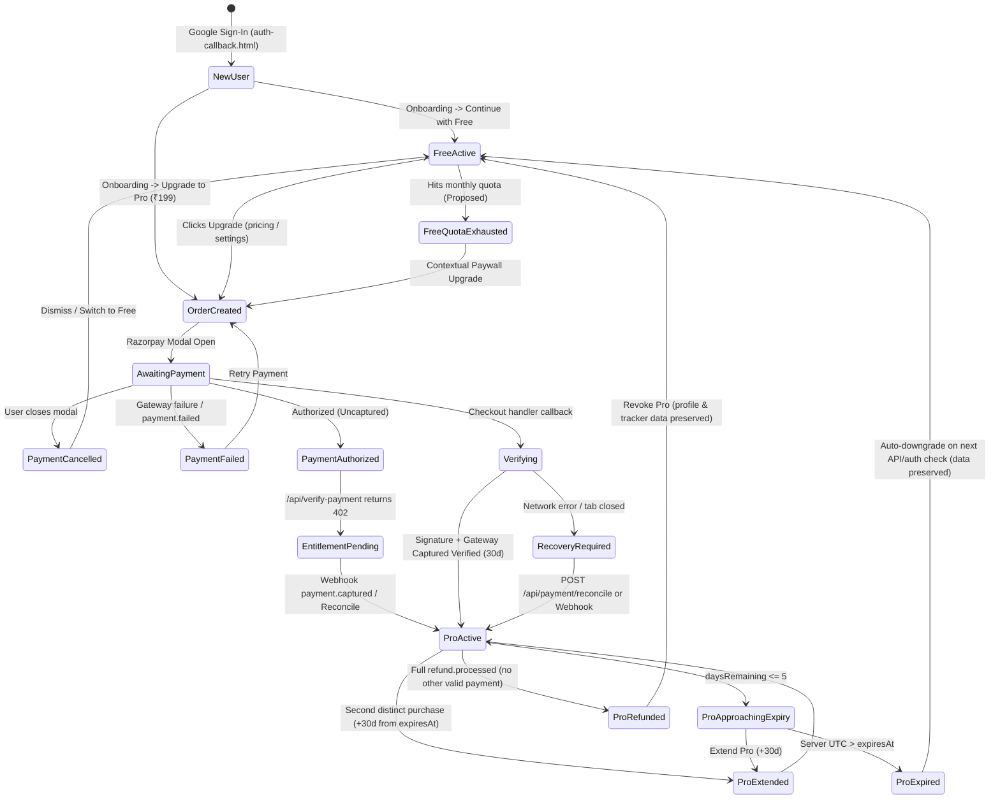

# JobXApply — Payment & Subscription State Map

## 1. Subscription Lifecycle State Transition Diagram

---

## 2. Customer-Facing Payment & Subscription States

| State | Current UI | Current Backend Status | Expected User Message | Recovery / Retry | Misleading Today? |
| :--- | :--- | :--- | :--- | :--- | :--- |
| **Checkout Initializing / Order Created** | Button text: `Loading Checkout...` / `Creating Order...` | `payment_orders.status = 'created'` | "Creating 30-day prepaid Pro order (₹199)..." | Locked against double-click (`_checkoutInFlight`) | No |
| **Awaiting Payment** | Razorpay modal open; `onboarding.html` shows spinner | `payment_orders.status = 'created'` | "Complete ₹199 payment in the Razorpay window." | Modal dismissible | No |
| **Payment Cancelled** | Toast: `"Payment cancelled."` (`pricing/settings`) or fallback screen (`onboarding`) | `payment_orders.status = 'created'` | "Checkout closed. No charges were made." | Retry or Continue Free | No |
| **Payment Failed** | Toast / error box with Razorpay `error.description` | `payments.payment_status = 'failed'` (via webhook) | "Payment failed: [reason]. No Pro charge applied." | Retry Payment | No |
| **Authorized (Uncaptured)** | Toast/error: `"Payment awaiting capture."` (`402`) | Not inserted as fulfilled | "Payment authorized by bank; waiting for capture. Use Recover Payment shortly." | `Recover Payment` button in Settings | Partially (needs clearer recovery CTA on `pricing.html` too) |
| **Verifying Payment** | Button text: `Verifying Payment...` | `POST /api/verify-payment` executing | "Verifying payment signature securely..." | Wait for response | No |
| **Payment Complete & Pro Active** | Badge flips to `PRO • ACTIVE`, `30 days remaining` | `payments.entitlement_status = 'fulfilled'`, `subscription_entitlements.status = 'active'` | "Pro activated! Valid for 30 days (no auto-renewal)." | Immediate access | **Yes** — `settings.html:529` says `"Renews on ..."` instead of `"Expires on ..."` |
| **Payment Recovery Required** | `Recover Payment` button in `settings.html` only | `payment_orders.status = 'created'` while Razorpay has captured payment | "Payment received — click Recover Payment to sync Pro access." | `POST /api/payment/reconcile` | **Yes** — `pricing.html` & `onboarding.html` lack an inline Recovery button |
| **Pro Approaching Expiry (≤ 5 days)** | Amber text color when `daysLeft <= 5` (`settings.html:464`) | `subscription_entitlements.status = 'active'` | "Your 30-day Pro pass expires in X days. Extend anytime." | `Extend Pro (+30 Days)` | **Yes** — Button says `Extend / Renew`, needs expiry banner on `dashboard.html` |
| **Pro Expired** | Shows `FREE TIER` on next load | Auto-downgraded to `status = 'expired'`, `users.tier = 'free'` | "Your 30-day Pro pass expired on [date]. Your data is safe; extend anytime." | Upgrade again | Missing dedicated "Pro Expired" notice |
| **Refund Requested / Processing / Completed** | No dedicated refund UI; flips back to `FREE TIER` | `refunds.refund_status = 'created' | 'processed'` | "Refund processed for payment [id]. Account reverted to Free." | Support email | Missing refund status visibility in billing history |
