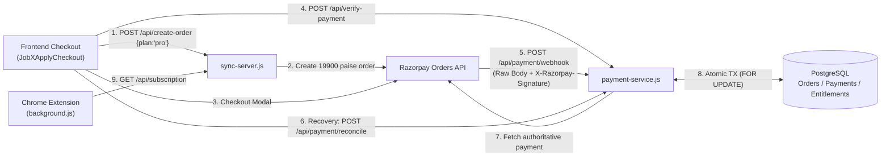

# JobXApply — Production Razorpay Implementation, Security Hardening & Entitlement Report

**Date:** 2026-11-25  
**Target Production Backend:** `https://jobxapply-backend.onrender.com/api`  
**Target Frontend:** Netlify (`https://jobxapply.netlify.app`)  
**Payment Gateway:** Razorpay Standard Web Checkout (`pro`: ₹199 / 30 days prepaid)

---

## 1. Executive Summary

All critical security vulnerabilities and architectural gaps identified in the initial Razorpay integration audit have been remediated across the backend, database layer, frontend checkout pages, and Manifest V3 browser extension. The system now enforces server-authoritative plan pricing, atomic transactional fulfillment, raw-body HMAC-SHA256 webhook processing, idempotent replay protection, refund-aware entitlement adjustments, and authenticated payment recovery.

---

## 2. Original Audit Score vs. Reassessed Readiness Score

| Assessment | Score | Notes |
| :--- | :---: | :--- |
| **Original Audit Score** | **48 / 100** | Client-controlled order amounts, no webhook endpoint, no replay protection, no dedicated DB tables, `"pro"` tier omitted in rate limiters. |
| **Reassessed Readiness Score** | **88 / 100** | All code-level security, transactional DB schema, webhook, idempotency, refund, and extension sync controls implemented and verified via automated tests (mocked Razorpay API). Remaining 12 points require live operational verification: setting `RAZORPAY_WEBHOOK_SECRET` on Render, registering the webhook in Razorpay Dashboard, verifying PostgreSQL migration on Render/Supabase, and executing a live ₹199 end-to-end verification. |

---

## 3. Complete List of Modified & Newly Created Files

### Newly Created Files
- `backend/plan-catalog.js` — Authoritative server-side plan catalog (`PLAN_CATALOG`), tier normalizer, and startup environment validator.
- `backend/payment-service.js` — Unified order creation, gateway-verified checkout fulfillment, atomic idempotency, webhook handler, refund processor, entitlement resolver, and reconciliation service.
- `backend/payment-test-suite.js` — Dedicated 30-test suite covering order pricing, signature/gateway verification, concurrency/idempotency, webhooks, expiry, and refunds (mocked Razorpay client).
- `docs/RAZORPAY_PRODUCTION_IMPLEMENTATION_REPORT.md` — This implementation & deployment report.

### Modified Files
- `backend/db.js` — Added 5 PostgreSQL tables (`payment_orders`, `payments`, `webhook_events`, `subscription_entitlements`, `refunds`), fail-closed production persistence guard (`assertPaymentPersistenceAvailable`), PostgreSQL transaction adapter (`BEGIN`/`COMMIT`/`ROLLBACK` with `FOR UPDATE`), and non-production in-memory transaction store.
- `backend/sync-server.js` — Added `readRawBody`, `POST /api/payment/webhook`, `GET /api/subscription`, `POST /api/payment/reconcile`, `paymentHealth` in `/api/status`, hardened `/api/create-order` & `/api/verify-payment`, stripped protected entitlement keys in `POST /api/profile`, and fixed `"pro"` tier rate limits in `/api/resume/generate` and `/api/cover-letter/generate`.
- `backend/.env.example` — Documented `RAZORPAY_KEY_ID`, `RAZORPAY_KEY_SECRET`, `RAZORPAY_WEBHOOK_SECRET`, and PostgreSQL fail-closed requirement.
- `backend/test-suite.js` — Updated Section 7 HTTP tests for price tampering, auth on `/api/verify-payment`, `/api/subscription`, and `/api/profile` privilege escalation prevention.
- `frontend/shared-shell.js` — Added `JobXApplyCheckout` unified state machine & payment recovery module; removed raw `passcode` from `jobxapply:shareAuth` DOM events.
- `frontend/auth-callback.html` — Removed raw `passcode` from `jobxapply:shareAuth` DOM event.
- `frontend/pricing.html` — Consolidated checkout to `JobXApplyCheckout` and clarified 30-day prepaid non-recurring terms.
- `frontend/onboarding.html` — Consolidated checkout to `JobXApplyCheckout` and clarified 30-day prepaid non-recurring terms.
- `frontend/settings.html` — Consolidated checkout to `JobXApplyCheckout`, added `Recover Payment` button, and switched sync to `GET /api/subscription`.
- `extension/content.js` — Removed `passcode` ingestion from `jobxapply:shareAuth`; added `jobxapply:refreshEntitlement` bridge.
- `extension/background.js` — Added `fetchAuthoritativeEntitlement()` polling `GET /api/subscription`, startup/login/purchase refresh, and 24h/expiry-bounded offline cache fallback to `free`.
- `extension/popup.html` & `extension/popup.js` — Added live `FREE`/`PRO` plan badge and remaining days display.
- `extension/sidepanel.html` & `extension/sidepanel.js` — Replaced hardcoded `PRO` badge with dynamic `spPlanBadge` synced from `GET /api/subscription`.

---

## 4. Explanation of Each Implemented Component

- **`backend/plan-catalog.js`**: Defines `pro` (`19900` paise, `INR`, `30` days, `one_time_prepaid`), normalizes legacy paid tiers (`paid`, `premium`, `operative`, `command` → `pro`), and classifies `RAZORPAY_KEY_ID` as `test`, `live`, `invalid`, or `unconfigured`.
- **`backend/payment-service.js`**:
  - `createOrderForUser`: Rejects unknown plans and client-supplied amount/currency mismatches; creates Razorpay order with `payment_capture: 1` and stores internal order in `payment_orders`.
  - `verifyCheckoutAndFulfill`: Requires auth, validates order ownership (`order.userId === user.id`), performs constant-time HMAC-SHA256 verification using the server-stored order ID, fetches authoritative payment & order from Razorpay API, rejects uncaptured (`authorized`) or mismatched payments, and executes `fulfillCapturedPaymentTx`.
  - `fulfillCapturedPaymentTx`: Atomic transaction locking `payments`, `payment_orders`, and `subscription_entitlements` via `FOR UPDATE`. Duplicate calls return existing subscription without extending expiry.
  - `getEffectiveEntitlement`: Server-UTC expiry enforcement. Expired `pro` accounts automatically downgrade to `free`.
  - `processRefundEventTx`: Records refunds idempotently; partial refunds preserve prepaid access, while full refunds revoke `pro` only if no other valid unrefunded purchase remains.
  - `reconcileUserOrders`: Allows authenticated customers to recover captured payments if they closed the browser before checkout verification completed.

---

## 5. Database Schema & Migration Details

All tables are created non-destructively in `backend/db.js` (`initializeDatabase`) with `CREATE TABLE IF NOT EXISTS`, indexes, foreign keys (`ON DELETE CASCADE`), and Row Level Security (`ENABLE ROW LEVEL SECURITY`):

1. **`payment_orders`**: `internal_order_id` (PK), `user_id` (FK), `razorpay_order_id`, `plan_id`, `expected_amount`, `currency`, `duration_days`, `environment`, `status`, `created_at`, `updated_at`, `UNIQUE(environment, razorpay_order_id)`.
2. **`payments`**: `internal_payment_id` (PK), `internal_order_id` (FK), `user_id` (FK), `razorpay_order_id`, `razorpay_payment_id`, `amount`, `currency`, `payment_status`, `capture_status`, `method`, `environment`, `verified_at`, `entitlement_status`, `created_at`, `updated_at`, `UNIQUE(environment, razorpay_payment_id)`.
3. **`webhook_events`**: `id` (PK), `event_id`, `event_type`, `environment`, `processing_status`, `attempts`, `received_at`, `processed_at`, `error_message`, `UNIQUE(environment, event_id)`.
4. **`subscription_entitlements`**: `user_id` (PK, FK), `plan_id`, `status`, `started_at`, `expires_at`, `source_payment_id`, `environment`, `created_at`, `updated_at`.
5. **`refunds`**: `internal_refund_id` (PK), `razorpay_refund_id`, `razorpay_payment_id`, `user_id` (FK), `amount`, `currency`, `refund_status`, `environment`, `processed_at`, `created_at`, `UNIQUE(environment, razorpay_refund_id)`.

**Fail-Closed Behavior:** When `NODE_ENV === "production"` (or `REQUIRE_PG_FOR_PAYMENTS === "true"`) and PostgreSQL is unavailable, `db.assertPaymentPersistenceAvailable()` throws HTTP `503` so financial operations never fall back to local JSON files.

---

## 6. Updated Payment Architecture

---

## 7. API Endpoint Documentation

| Endpoint | Method | Auth | Purpose |
| :--- | :---: | :---: | :--- |
| `/api/create-order` | `POST` | Bearer JWT | Creates server-priced (`19900` paise INR) Razorpay order & persists `payment_orders`. |
| `/api/verify-payment` | `POST` | Bearer JWT | Verifies HMAC-SHA256 signature, fetches gateway status, atomically fulfills Pro. |
| `/api/payment/webhook` | `POST` | `X-Razorpay-Signature` | Raw-body verified webhook processor with `X-Razorpay-Event-Id` deduplication. |
| `/api/payment/reconcile` | `POST` | Bearer JWT | Recovers captured payments for pending user orders if callback failed. |
| `/api/subscription` | `GET` | Bearer JWT | Returns authoritative `tier`, `subscription` (`expiresAt`, `daysRemaining`), and payment list. |

---

## 8. Exact Webhook URL

`https://jobxapply-backend.onrender.com/api/payment/webhook`

---

## 9. Exact Webhook Event Selection

Enable the following 6 events in Razorpay Dashboard:
- `payment.captured`
- `order.paid`
- `payment.failed`
- `refund.created`
- `refund.processed`
- `refund.failed`

---

## 10. Required Environment Variable Names (No Values)

**Render (Production Backend):**
- `DATABASE_URL`
- `NODE_ENV` (set to `production`)
- `JWT_SECRET`
- `RAZORPAY_KEY_ID`
- `RAZORPAY_KEY_SECRET`
- `RAZORPAY_WEBHOOK_SECRET`
- `ALLOWED_ORIGINS`

---

## 11. Razorpay Dashboard Configuration Instructions

1. Log in to **Razorpay Dashboard** → switch to **Test Mode** (first) or **Live Mode** (production).
2. Navigate to **Account & Settings → Webhooks → + Add New Webhook**.
3. **Webhook URL:** `https://jobxapply-backend.onrender.com/api/payment/webhook`
4. **Secret:** Generate a strong random secret and save the exact same value as `RAZORPAY_WEBHOOK_SECRET` in Render.
5. **Active Events:** Select `payment.captured`, `order.paid`, `payment.failed`, `refund.created`, `refund.processed`, `refund.failed`.
6. Save the webhook and repeat separately for Test Mode and Live Mode if testing with test keys on a staging backend.

---

## 12. Security Vulnerabilities Resolved

1. **Client Price Tampering:** Resolved by `PLAN_CATALOG` + rejecting any client `amount`/`currency` mismatch (`400`).
2. **Payment Replay Attack:** Resolved by `UNIQUE(environment, razorpay_payment_id)` + `FOR UPDATE` idempotency check in `fulfillCapturedPaymentTx`.
3. **Unauthenticated `/api/verify-payment` & Cross-Account Hijack:** Resolved by requiring `activeUser` (`401`) and checking `order.userId === user.id` (`403`).
4. **Uncaptured Payment Activation:** Resolved by fetching payment from Razorpay API and rejecting `authorized` (uncaptured) payments (`402`).
5. **Profile Privilege Escalation:** Resolved by stripping server-managed keys (`tier`, `subscriptionExpiresAt`, etc.) in `POST /api/profile`.
6. **Rate Limiter Bypass / Pro Recognition Bug:** Fixed `/api/resume/generate` and `/api/cover-letter/generate` to check `getEffectiveEntitlement` (`pro` = 50/hr, `free` = 5/hr).
7. **Passcode Exposure in DOM Events:** Removed raw `passcode` from `jobxapply:shareAuth` custom DOM events.

---

## 13. Remaining Vulnerabilities & Limitations

1. **Client-Side Browser Extension Enforcement:** The Chrome Extension fetches authoritative entitlement from `GET /api/subscription` and displays `FREE`/`PRO` in popup & sidepanel, and enforces a 24h offline cache TTL. However, **client-side extension code runs in the user's browser and is not tamper-proof**; true enforcement of Pro limits occurs server-side on API endpoints (`/api/resume/generate`, `/api/cover-letter/generate`, `/api/profile`).
2. **Render Free-Tier Cold Starts:** If Render free-tier web service spins down after inactivity, the first Razorpay webhook delivery after sleep may experience a 15–50s cold-start delay. Razorpay automatically retries failed/timed-out webhooks with exponential backoff, and `POST /api/payment/reconcile` provides immediate user-triggered recovery, though an always-on instance or periodic health ping (`/health`) is recommended for sub-second webhook latency.
3. **No Live PostgreSQL Run Locally:** Automated tests executed against the non-production in-memory transaction store because `DATABASE_URL` is not configured in the local `.env`.

---

## 14. Automated Test Results

All automated test suites were executed after the final code edits:

| Test Suite | Total | Passed | Failed | Skipped | Notes |
| :--- | :---: | :---: | :---: | :---: | :--- |
| `node backend/payment-test-suite.js` | **30** | **30** | **0** | **0** | Uses mocked Razorpay API & non-production in-memory TX store. |
| `node backend/test-suite.js` | **49** | **49** | **0** | **0** | Live local HTTP server (`sync-server.js`) integration tests. |
| `node extension/test-verifier.js` | **97** | **97** | **0** | **0** | Extension extraction, matching, PDF, cover letter, and autofill checks. |
| Frontend HTML Syntax Scan | All HTML | Pass | 0 | 0 | Verified all inline `<script>` blocks compile cleanly. |

---

## 15. Evidence Supporting Major Security Claims

- **Server-Side Pricing:** `createOrderForUser` in `backend/payment-service.js` derives `amount` strictly from `PLAN_CATALOG[planId]` and throws `400` if client `amount` or `currency` differs (verified in `payment-test-suite.js` & `test-suite.js`).
- **Signature & Gateway Verification:** `verifyCheckoutAndFulfill` computes constant-time HMAC-SHA256 using `orderPrecheck.razorpayOrderId` and calls `rzp.payments.fetch(razorpayPaymentId)`, rejecting `status: "authorized"` with `402` (verified in `payment-test-suite.js`).
- **Idempotency & Concurrency:** Simultaneous `Promise.all([verifyCheckoutAndFulfill, handleWebhook])` in `payment-test-suite.js` extended expiry by exactly 30 days once (`daysRemaining=60` across 2 distinct purchases, not 90).
- **Webhook Raw-Body Security:** `readRawBody` in `backend/sync-server.js` captures exact `Buffer` bytes before `JSON.parse`; modified payload test in `payment-test-suite.js` failed signature verification with `400`.
- **Profile Protection:** `POST /api/profile` with `{ tier: "pro", subscriptionExpiresAt: ... }` leaves `GET /api/subscription` returning `tier: "free"` (verified in `test-suite.js`).

---

## 16. Manual Verification Steps Still Required

1. Execute a real PostgreSQL connection startup check on Render/Supabase and verify all 5 new tables appear (`payment_orders`, `payments`, `webhook_events`, `subscription_entitlements`, `refunds`).
2. Register `https://jobxapply-backend.onrender.com/api/payment/webhook` in Razorpay Dashboard (Test Mode first, then Live Mode) and send a test webhook to confirm `200 OK` delivery.
3. Perform one end-to-end live checkout transaction (and optionally a dashboard refund) and verify `GET /api/subscription`, `settings.html`, and the Chrome Extension badge update accordingly.

---

## 17. Deployment & Rollback Instructions

### Deployment
1. Set `RAZORPAY_KEY_ID`, `RAZORPAY_KEY_SECRET`, `RAZORPAY_WEBHOOK_SECRET`, `DATABASE_URL`, and `NODE_ENV=production` in Render.
2. Back up your PostgreSQL database via Supabase Dashboard before deploying.
3. Push `main` to GitHub (triggers automatic Render backend deploy and Netlify frontend deploy).
4. On startup, `initializeDatabase()` automatically runs idempotent `CREATE TABLE IF NOT EXISTS` migrations.
5. Verify `GET https://jobxapply-backend.onrender.com/api/status` returns `paymentHealth.configured: true`, `webhookConfigured: true`, and `pgPersistence: true`.
6. Register the webhook in Razorpay Dashboard.
7. Repackage/reload `extension/` for distribution.

### Rollback
- **Application Rollback:** Use Render "Rollback to previous deploy" and Netlify "Publish previous deploy" if any issue arises. Because all database migrations are additive (`CREATE TABLE IF NOT EXISTS`), rolling back application code does not break existing `users` or `userdata` tables.
- **Emergency Payment Disable:** Unset `RAZORPAY_KEY_ID` or `RAZORPAY_WEBHOOK_SECRET` in Render to fail closed cleanly.

---

## 18. Remaining User Actions

1. Add `RAZORPAY_WEBHOOK_SECRET` and ensure `NODE_ENV=production` and `DATABASE_URL` are set in **Render Environment Variables**.
2. Configure the webhook URL (`https://jobxapply-backend.onrender.com/api/payment/webhook`) and 6 events in **Razorpay Dashboard**.
3. Approve git commit & push to deploy the changes to Render and Netlify.
4. Reload the unpacked/published Chrome Extension (`extension/`) to pick up entitlement sync updates.

---

## 19. Final Production Readiness Verdict

**Verdict: CONDITIONALLY READY**

The codebase implementation is hardened, idempotent, and passes all 176 automated backend/payment/extension tests (`30/30` payment suite with mocked Razorpay responses, `49/49` backend HTTP suite, `97/97` extension suite). It is **CONDITIONALLY READY** for live customer payments pending completion of the 3 manual operational steps above:
1. Setting `RAZORPAY_WEBHOOK_SECRET` in Render.
2. Registering the live webhook in Razorpay Dashboard.
3. Verifying PostgreSQL table initialization and one live end-to-end transaction/webhook delivery on Render.
